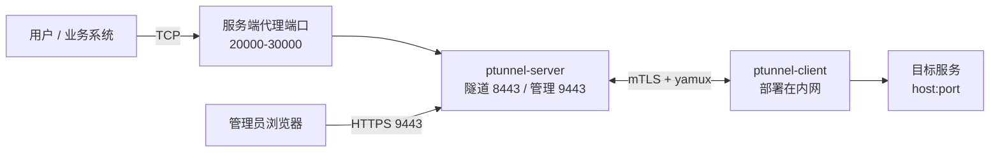

# PortTunnel

PortTunnel 是一套自托管的 TCP 内网穿透与端口映射系统：客户端部署在内网，主动外连服务端建立 mTLS 隧道；服务端对外暴露代理端口，把访问流量转发到内网目标，并提供 Web 管理台、连接审计、SQL 语句审计与运行状态监控。

当前版本：**v0.4.0**

## 功能特性

- **mTLS 隧道**：强制 TLS 1.3 + 双向认证 + yamux 多路复用，客户端无需公网 IP、无需入站放行；隧道端口按 ALPN 分流，对外表现为普通 HTTP/2 长连接。
- **动态端口映射**：服务端热加载代理端口（默认 `20000-30000`），支持来源 IP 白名单、单代理连接上限与限速。
- **集中管理**：客户端注册令牌、证书签发/吊销、代理审批、启停与配置下发均可在 Web 管理台完成。
- **在线升级**：上传各平台（amd64 / arm64 / armv7）客户端产物后，管理台可对版本较低的客户端一键升级，客户端自动领取对应架构的包，校验 sha256 后原地重启。
- **连接审计**：记录来源 IP/端口/MAC、代理、目标地址、起止时间、双向字节与结束原因；支持 `full / sample / off`。
- **SQL 语句审计**：对绑定应用类型的代理解析明文协议，提取 MySQL/MariaDB、PostgreSQL、SQL Server、Oracle/达梦、Redis、MongoDB 的语句或命令，按天落盘并自动压缩清理。
- **运维检测**：仪表盘展示进程 CPU、内存、线程/句柄、Goroutine、隧道会话、监听端口与所有在途转发连接（含实时上下行字节），每 5 秒刷新。
- **可观测性**：`/healthz`、Prometheus `/metrics`，可选 pprof 调试端口。
- **存储可选**：默认内嵌 SQLite，零运维；也支持 MySQL 8.0 / 5.7。

## 架构



| 组件 | 作用 | 默认端口 |
| --- | --- | --- |
| `ptunnel-server` | 对外暴露代理端口、隧道接入、Web 管理台 | 隧道 `8443`、管理 `9443` |
| `ptunnel-client` | 内网侧主动外连服务端并执行转发 | 无监听端口 |

## 快速开始

### 1. 启动服务端（Linux 发布包）

```bash
mkdir -p /opt/ptunnel
tar xzf ptunnel-0.4.0-linux-amd64.tar.gz -C /opt/ptunnel --strip-components=1
cd /opt/ptunnel
chmod +x ptunnel-server ptunnel-client

export PTUNNEL_ADMIN_PASSWORD='请改成强口令'
./ptunnel-server -c server.yaml
```

首次启动会在 `data/` 生成内部 CA、隧道/管理证书与 SQLite 数据库。浏览器访问 `https://<服务器IP>:9443`，使用 `admin` 与上面设置的口令登录。

### 2. 创建客户端并注册

1. 管理台 →「客户端」→「新建客户端」，复制弹出的注册令牌（15 分钟有效、仅显示一次）；
2. 编辑 `client.yaml`：

```yaml
server:
  addr: <服务端地址>:8443
  enroll_token: <注册令牌>
  name: web01
tunnel:
  half_close_grace: 500ms
security:
  allow_targets:
    - 10.0.0.0/8
    - 192.168.0.0/16
```

3. 启动客户端：

```bash
./ptunnel-client -c client.yaml
```

看到 `隧道已建立` 即注册成功；证书有效期 90 天，剩余不足 30 天会自动续期。

### 3. 创建代理并访问

管理台 →「端口代理」→「新建代理」：选择客户端、填写服务端端口（如 `23306`）、转发目标（如 `10.1.2.3:3306`），保存后立即监听。之后从外部访问 `<服务端IP>:23306` 即可。

客户端本地登记的代理默认为「待审批」，管理员在「端口代理」页通过后生效。

## 客户端在线升级

管理台 →「客户端」→「版本管理」上传各平台的客户端二进制，填写版本号与架构；随后在客户端列表中，版本低于该平台最新包的机器会显示「可升级」标记，点「升级」即可。

服务端按客户端上报的 `os + arch` 精确匹配升级包，因此同一版本需要**按架构分别上传**（`amd64` / `arm64` / `arm`）。海光 C86 等 x86_64 兼容平台使用 `amd64` 包。

交叉编译时**务必注入版本号**，否则客户端会以 `dev` 上报（虽仍可被升级，但无法区分先后）：

```bash
V=0.5.0
GOOS=linux GOARCH=amd64 go build -trimpath -ldflags "-s -w -X main.version=$V" -o ptunnel-client_${V}_amd64 ./cmd/ptunnel-client
GOOS=linux GOARCH=arm64 go build -trimpath -ldflags "-s -w -X main.version=$V" -o ptunnel-client_${V}_arm64 ./cmd/ptunnel-client
GOOS=linux GOARCH=arm GOARM=7 go build -trimpath -ldflags "-s -w -X main.version=$V" -o ptunnel-client_${V}_armv7 ./cmd/ptunnel-client
```

升级流程与约束：

- 升级包存放在 `data/releases/`，元数据（版本/平台/大小/sha256）入库；同一 `版本 + 系统 + 架构` 只能存在一个包，覆盖前需先删除；
- 客户端下载走隧道端口的 mTLS 接口，边下边算 sha256，与指令中的值不一致立即丢弃；
- 替换采用「同目录临时文件 → 原子 rename」，失败不影响原有二进制；替换前会保留一份 `.bak` 便于回滚；
- 替换成功后客户端用 `syscall.Exec` 原地重启（PID 不变），**仅支持 Linux / macOS 客户端**；Windows 客户端会返回「不支持在线升级」，需手工替换；
- 客户端二进制所在目录必须可写，否则升级失败并回报原因（列表中「升级失败」可悬停查看详情）；
- 升级期间该客户端承载的代理连接会短暂中断。

## Docker 部署

仓库根目录提供多阶段 [Dockerfile](Dockerfile)，运行镜像为非 root、Alpine、含健康检查。

```bash
docker build -t ptunnel-server:0.4.0 --build-arg VERSION=0.4.0 .

docker run -d --name ptunnel-server \
  -p 8443:8443 \
  -p 9443:9443 \
  -p 23306:23306 \
  -v /opt/ptunnel/data:/opt/ptunnel/data \
  -e PTUNNEL_ADMIN_PASSWORD='请改成强口令' \
  ptunnel-server:0.4.0
```

说明：

- `8443` 为隧道端口，`9443` 为管理台；代理端口需按实际规则**逐个 `-p` 映射**（`EXPOSE 20000-30000` 仅作声明）。
- 务必挂载 `/opt/ptunnel/data`：内部 CA、证书、SQLite、SQL 审计文件都在这里；`data/ca.key` 需离线备份。
- 镜像内 Web 管理台已预构建并嵌入二进制；修改前端源码后需先 `npm run build` 再构建镜像。

## 配置说明

### server.yaml（常用项）

| 配置 | 默认 | 说明 |
| --- | --- | --- |
| `server.tunnel_addr` | `0.0.0.0:8443` | 隧道接入与证书注册共用端口（ALPN 分流） |
| `server.admin_addr` | `0.0.0.0:9443` | 管理台 HTTPS |
| `server.port_range` | `[20000, 30000]` | 允许映射的端口范围 |
| `server.pprof_addr` | 空 | 可选 pprof 调试地址（如 `127.0.0.1:6060`），留空关闭 |
| `storage.driver` | `sqlite` | `sqlite` / `mysql` |
| `tunnel.max_streams_per_client` | `4096` | 单客户端并发隧道流上限 |
| `tunnel.max_conns_per_proxy` | `0` | 单代理连接上限（0 不限） |
| `tunnel.half_close_grace` | `500ms` | 一端结束后等待另一方向收尾的时长，`0` 表示立即关闭 |
| `audit.conn_log_mode` | `full` | 连接审计 `full / sample / off` |
| `audit.sql_log_enabled` | `true` | 是否启用 SQL/命令审计（需代理绑定应用类型） |

### client.yaml（常用项）

| 配置 | 说明 |
| --- | --- |
| `server.addr` | 服务端隧道地址 |
| `server.enroll_token` | 一次性注册令牌，注册成功后可删除 |
| `tunnel.half_close_grace` | 客户端侧收尾等待，建议与服务端一致 |
| `security.allow_targets` | 本地硬限制：只允许转发到这些网段 |
| `proxies[]` | 本地登记的代理（需服务端审批） |

## 从源码构建

依赖 Go 1.21+、Node.js（仅前端构建需要）。

```bash
# 前端（产物输出到 internal/server/web/dist，供 go:embed 使用）
cd web && npm install && npm run build && cd ..

# 服务端 / 客户端
go build -trimpath -ldflags "-s -w -X main.version=0.4.0" -o bin/ptunnel-server ./cmd/ptunnel-server
go build -trimpath -ldflags "-s -w -X main.version=0.4.0" -o bin/ptunnel-client ./cmd/ptunnel-client

# 或使用 Makefile
make web build
make test
```

Linux 交叉编译（amd64 / arm64 / armv7）：

```bash
GOOS=linux GOARCH=amd64 go build -trimpath -ldflags "-s -w -X main.version=0.4.0" -o dist/amd64/ptunnel-server ./cmd/ptunnel-server
GOOS=linux GOARCH=arm64 go build -trimpath -ldflags "-s -w -X main.version=0.4.0" -o dist/arm64/ptunnel-server ./cmd/ptunnel-server
GOOS=linux GOARCH=arm GOARM=7 go build -trimpath -ldflags "-s -w -X main.version=0.4.0" -o dist/armv7/ptunnel-server ./cmd/ptunnel-server
```

## 目录结构

```text
cmd/                服务端与客户端入口
internal/agent/     客户端：注册、隧道维持、转发
internal/server/    服务端：API、Web、隧道会话、端口监听、代理转发
internal/audit/     连接审计（异步批量落库、MAC 解析）
internal/sqllog/    SQL 审计文件写入（按天分割、gzip、保留清理）
internal/sqlparse/  MySQL/PostgreSQL/TDS/Redis/MongoDB 等协议解析
internal/release/   客户端升级包的落盘、校验、版本比较与按平台选包
internal/store/     SQLite / MySQL 存储与迁移
internal/ops/       进程 CPU/内存/线程/句柄采集（Windows/Linux）
internal/tunnel/    TLS + yamux 隧道协议
web/                Vue 3 + Element Plus + ECharts 管理台
docs/               设计、选型、使用手册、问题处理、压测报告
packaging/systemd/  systemd 单元示例
Dockerfile          服务端镜像
```

## 监控与运维

| 接口 | 说明 |
| --- | --- |
| `GET /healthz` | 数据库、在线客户端数、监听数、运行时长、审计队列 |
| `GET /metrics` | Prometheus 文本指标（在线客户端、监听器、活跃连接、字节数、拒绝数、审计丢弃等） |
| `GET /api/system/runtime` | 需登录。进程 CPU/内存/线程/句柄、Go 运行时、隧道会话、监听端口、在途连接明细 |
| `server.pprof_addr` | 可选 pprof 端口，默认关闭且未鉴权，仅建议内网/本机开放 |

## 安全建议

1. 管理台不要直接暴露公网，使用安全组/防火墙限制来源；
2. 隧道端口只放行客户端出口 IP；
3. 代理规则尽量配置来源 IP 白名单；
4. 客户端 `allow_targets` 收紧到实际需要的网段，防止横向扩散；
5. `data/ca.key` 保持 `0600` 并离线备份，不要提交到代码仓库。

## 已知限制

- 仅支持 TCP 转发，暂不支持 UDP；
- 在线升级仅支持 Linux / macOS 客户端，Windows 客户端需手工替换二进制；
- 不支持 HTTP 域名/路径级路由；
- 单机部署（SQLite / MySQL），无多节点高可用；
- MAC 地址仅在客户端/访问者与服务端同二层时可得；
- 管理台与隧道证书默认自签，生产环境建议使用可信证书；
- 短连接吞吐受客户端操作系统 TIME_WAIT 端口预算限制，短连接占比高时可调小 `half_close_grace` 或使用连接池；
- 明文数据库协议才能提取 SQL，启用 TLS 的数据库连接仅保留连接审计。

## 文档

- [总体设计](docs/01-总体设计.md)
- [技术栈选型](docs/02-技术栈选型.md)
- [使用手册](docs/03-使用手册.md)
- [问题处理](docs/04-问题处理.md)
- [压测报告](docs/05-压测报告.md)

## 许可证

当前仓库未附带开源许可证文件；如需对外分发，请先补充合适的 LICENSE。