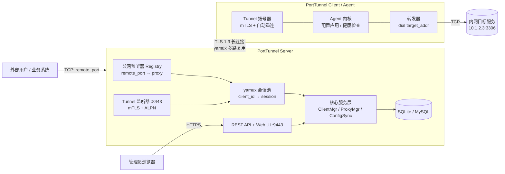
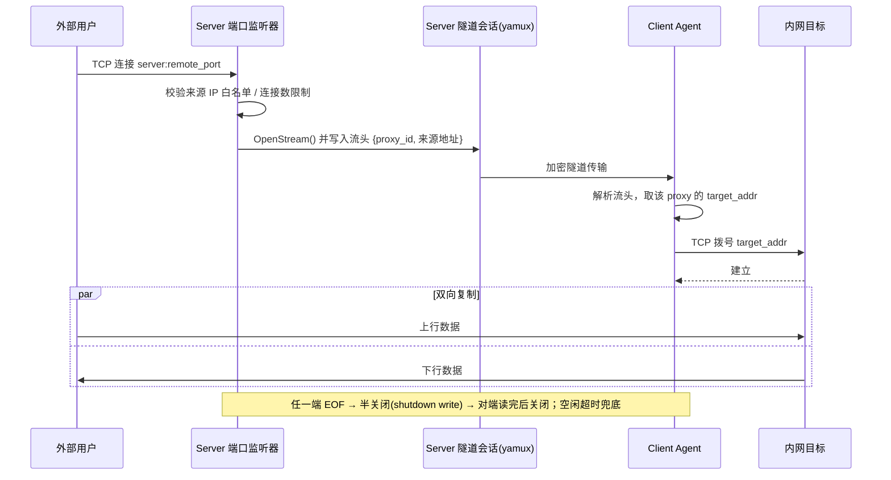
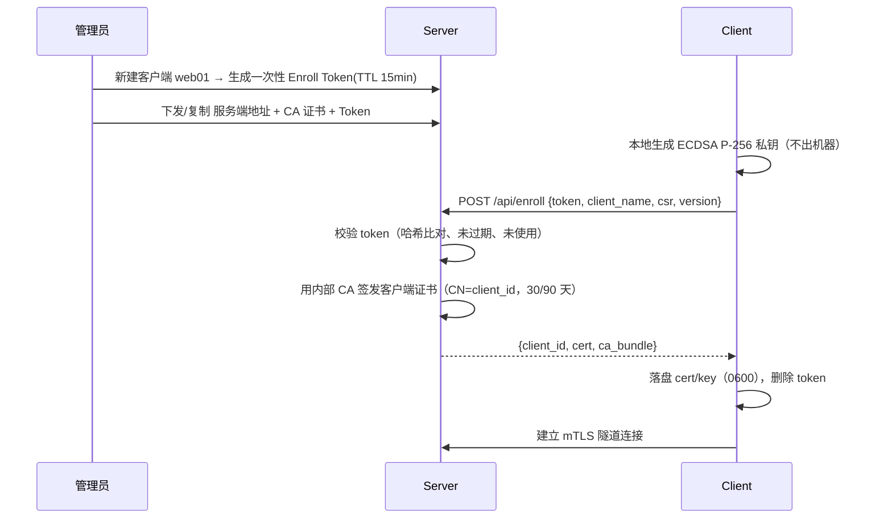
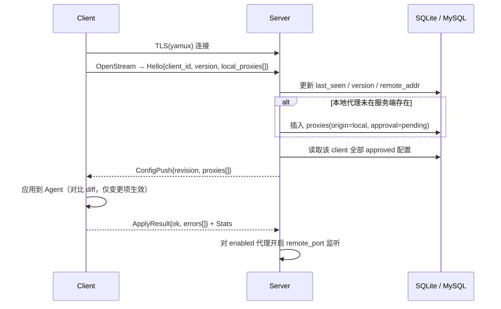
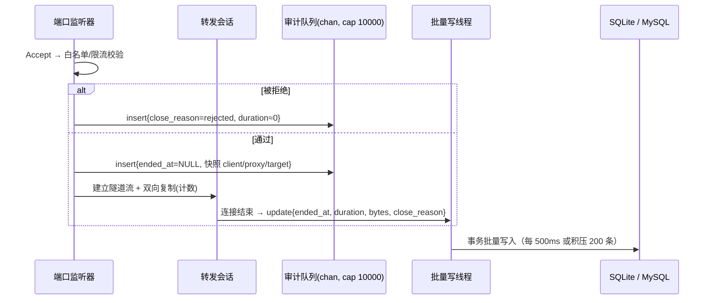

# PortTunnel 总体设计文档

> 版本：v0.1（设计稿）
> 日期：2026-11-20
> 范围：服务端 / 客户端架构、隧道协议、配置模型、数据模型、REST API、安全与部署设计

---

## 1. 项目概述

### 1.1 目标

用 Go 实现一套**反向端口隧道**系统（类 frp 的 remote port forwarding 模式）：

- 客户端主动连接服务端，建立一条加密长连接；
- 服务端在指定端口上监听，外部用户访问 `服务端IP:代理端口`；
- 流量经加密隧道转发到客户端，由客户端再转发到**客户端可访问的任意地址:端口**；
- 服务端提供 Web 界面统一管理所有客户端、代理端口与转发目标；
- 支持多客户端，服务端为配置的唯一权威来源；
- 客户端支持本地配置文件，并可将本地代理登记到服务端（默认需管理员审批）。

### 1.2 非目标（首版不做）

- HTTP 域名/路径级路由（vhost），仅做 TCP（UDP 作为二期可选）
- 多服务端集群 / 高可用（首版单机；存储可选 SQLite 或 MySQL）
- P2P 直连、NAT 穿透打洞
- 客户端本地 Web 界面（客户端仅命令行 + 配置文件）

### 1.3 术语

| 术语 | 含义 |
| --- | --- |
| Server | 中心服务端，持有公网入口端口，提供 Web 管理与隧道接入 |
| Client / Agent | 部署在内网侧，主动外连服务端，执行转发 |
| Proxy | 一条端口映射规则：`remote_port`（服务端监听）→ `target_addr`（客户端转发目标） |
| Tunnel | 客户端与服务端之间的 mTLS 长连接，内承载多路复用流 |
| Control Stream | 隧道内的第 1 条流，承载 JSON 控制消息（注册、配置下发、心跳、统计） |
| Remote Port | 服务端对外暴露的监听端口 |
| Target Addr | 客户端侧真正转发的目标地址，如 `10.1.2.3:3306` |
| Enroll Token | 一次性注册令牌，用于首次签发客户端证书 |

---

## 2. 需求分析

### 2.1 功能需求

| 编号 | 需求 | 说明 |
| --- | --- | --- |
| FR-1 | 隧道建立 | 客户端向服务端建立 mTLS 长连接，断线自动重连（指数退避） |
| FR-2 | 端口代理 | 服务端监听 `remote_port`，流量转发到客户端 `target_addr` |
| FR-3 | 多客户端 | 单服务端支持 N 个客户端，互不干扰；单客户端支持 N 条代理 |
| FR-4 | 服务端集中配置 | 服务端可增删改查客户端与代理规则，变更实时下发，无需重启/客户端手动干预 |
| FR-5 | 客户端本地配置 | 客户端配置文件声明服务端地址、证书、本地代理列表 |
| FR-6 | 本地配置登记 | 客户端上线时上报本地代理列表，服务端记录为 `pending`，管理员审批后生效 |
| FR-7 | Web 管理 | 登录、客户端/代理管理、在线状态、连接与流量看板、审计日志、系统设置 |
| FR-8 | 证书管理 | 一次性令牌注册、证书自动签发、到期自动轮换、证书吊销 |
| FR-9 | 访问控制 | 代理级别来源 IP 白名单（CIDR）、连接数上限、客户端目标地址白名单 |
| FR-10 | 配置审计与统计 | 配置变更全量操作审计；按代理统计连接数与字节流量 |
| FR-11 | 连接审计（访问日志） | 逐条记录每次访问：来源 IP/端口与 MAC（尽力获取）、所用服务端端口、对应客户端与代理、转发目标地址:端口、开始/结束时间、持续时长、上下行字节、结束原因；支持查询、筛选、导出、活跃连接查看 |
| FR-12 | 对外 API/CLI | REST API 可供脚本调用；服务端/客户端均提供 CLI |

### 2.2 非功能需求

| 编号 | 指标 | 目标 |
| --- | --- | --- |
| NFR-1 | 吞吐 | 单代理 ≥ 300 MB/s（本地回环基准），转发路径不使用缓冲拷贝以外的额外解析 |
| NFR-2 | 并发连接 | 单代理 ≥ 5000 并发 TCP 连接；单客户端 ≥ 10000 总计 |
| NFR-3 | 附加延迟 | 隧道转发引入的 RTT 增量 < 1 ms（同机房） |
| NFR-4 | 可用性 | 客户端断线 30 s 内自动恢复；服务端进程崩溃重启后配置与端口自动恢复监听 |
| NFR-5 | 安全 | 全链路 TLS 1.3 + 双向证书；管理口令 Argon2id；配置变更可审计 |
| NFR-6 | 部署 | 服务端、客户端均为**单二进制**（前端资源 embed），无外部运行时依赖 |
| NFR-7 | 资源 | 空载常驻内存 < 60 MB（服务端含 Web），单连接内存开销 < 100 KB |
| NFR-8 | 审计写入 | 连接审计异步批量落库，不阻塞转发路径；单条记录落库延迟 < 2 s；查询 30 天 100 万行内列表接口 P95 < 500 ms |

---

## 3. 总体架构

### 3.1 组件图



### 3.2 数据面路径（关键设计）



**为什么用 yamux 而不是「每个连接各开一条 TLS」**：一条长连接 + 多路复用可避免每连接 TLS 握手开销、复用 NAT/防火墙状态、连接复用率高；对比 gRPC 更轻量且支持裸字节流。

**审计埋点**：每次连接在建立（含被拒绝）与结束各产生一次审计事件，记录来源 IP/端口/MAC、服务端端口、客户端、代理、目标地址、起止时间与时长、双向字节、结束原因，详见第 10 节。

### 3.3 控制面

- 客户端建连后打开第 1 条流作为**控制流**，使用「4 字节大端长度 + JSON」帧协议。
- 服务端在控制流上：下发全量期望配置（ConfigPush）、心跳 Ping/Pong、下发断开/重载指令、收集运行统计。
- 服务端保存 `client_id → *yamux.Session` 映射；会话关闭即标记客户端离线。

### 3.4 端口管理

- `PortRegistry` 负责 `remote_port` 的动态 `net.Listen` / `Close`，增删改配置时热生效，不重启进程。
- 写入前做**冲突检测**：同一 `(bind_addr, protocol, port)` 唯一；并与系统实际占用做试探（`bind` 失败即报错，UI 标红）。
- 支持配置允许的端口范围（默认 `20000-30000`），防止误占 22/80 等系统端口。
- 端口监听失败不阻塞其他代理，状态回写为 `error` + 原因，UI 可一键重试。

---

## 4. 关键流程

### 4.1 首次注册与证书签发（Enrollment）



要点：

- 首个请求的传输安全：客户端使用**预置 CA 证书**校验服务端，或用 `--server-fingerprint sha256:xx` 做证书指纹固定（TOFU）。
- Token 以 SHA-256 存储，用后即失效；重复使用直接拒绝。
- 客户端证书 `ExtendedKeyUsage = ClientAuth`，`CN = client_id`，SAN 不含域名。
- 之后所有隧道连接、续期请求均要求 mTLS。

### 4.2 上线与配置同步



- 配置带 `revision`（单调递增），客户端丢弃旧版本，避免乱序覆盖。
- 客户端仅上报、不擅自启用本地未审批的代理；管理员审批后由服务端推送生效。

### 4.3 配置变更推送

服务端任意写操作 → `ConfigSync.Push(client_id)`：

1. 重新计算该客户端期望配置 → `revision++`；
2. 通过控制流下发 `ConfigPush`；
3. 等待 `ApplyResult`（默认 10 s 超时，超时在 UI 提示「客户端未确认」）；
4. 服务端侧同步调整端口监听器（增量 diff）。

### 4.4 断线与重连

- 客户端指数退避：1s → 2s → 4s … 上限 30s，带 ±20% 抖动；连接成功后重置。
- 服务端以心跳判活：每 15 s Ping，连续 3 次（45 s）无 Pong 关闭会话并标记离线。
- 会话关闭时：该客户端所有代理的**公网监听器继续保留**（避免端口漂移），但新连接直接拒绝并计数（快速失败，不给用户长时间挂起）。

### 4.5 证书轮换与吊销

- 客户端在剩余有效期 < 1/3 时调用 `POST /api/client/cert/renew`（mTLS），以旧证书换新证书，热加载无需重启。
- 管理员吊销：`POST /api/clients/{id}/revoke-cert` → 记录 `revoked_at`，并在 TLS 层通过 `VerifyPeerCertificate` 校验吊销表，立即断开在线会话。

### 4.6 优雅关闭

SIGTERM → 停止接受新连接 / 关闭 Web → 通知客户端 `ServerShutdown{retry_after}` → 关闭隧道 → 等待在途连接（默认 10 s，可强制）→ 关闭监听器 → 退出。

---

## 5. 隧道协议设计

### 5.1 传输层

| 项 | 取值 |
| --- | --- |
| 传输 | TCP + TLS 1.3（强制，禁用 TLS 1.2） |
| 认证 | 双向证书（服务端 CA 签发），`VerifyPeerCertificate` 附加吊销检查 |
| ALPN | `h2`（伪装为普通 HTTP/2，避免抓包识别；兼容旧值 `ptunnel/1`） |
| 多路复用 | `hashicorp/yamux`（服务端 Accept、客户端 Dial，流模式） |
| 保活 | yamux keepalive 关闭，改由控制流应用层 Ping（避免与业务空闲混淆） |

### 5.2 控制帧

```
+--------+------------------+----------------------+
| 4 Byte | 1 Byte MsgType   | N Byte JSON Payload  |
| Length |                  |                      |
+--------+------------------+----------------------+
```

消息类型：

| Type | 方向 | Payload 摘要 |
| --- | --- | --- |
| `hello` | C→S | client_id, version, os/arch, local_proxies[] |
| `hello_ack` | S→C | server_time, heartbeat_interval |
| `config_push` | S→C | revision, proxies[{id,name,proto,remote_port,target_addr,enabled,max_conns,allow_cidrs}] |
| `apply_result` | C→S | revision, ok, errors[{proxy_id,msg}] |
| `stats` | C→S | proxies[{proxy_id, active_conns, bytes_in, bytes_out}]（每 10 s） |
| `ping` / `pong` | 双向 | seq, ts |
| `kick` | S→C | reason（配置禁用/证书吊销） |
| `server_shutdown` | S→C | retry_after_sec |
| `upgrade` | S→C | version, os, arch, size, sha256（在线升级指令） |
| `upgrade_result` | C→S | version, ok, message（升级执行结果） |

### 5.3 数据流头

每条数据流开头写入（1 次写，定长 + 变长字段）：

```
+-----+--------+------------+--------+--------------+
| Ver | PLen   | ProxyID    | SLen   | SourceAddr   |
| 1B  | 2B BE  | PLen Byte  | 2B BE  | SLen Byte    |
+-----+--------+------------+--------+--------------+
```

- `Ver=1`，`ProxyID` 为 UUID 字符串；`SourceAddr` 为 `ip:port`，用于客户端日志与目标侧透传（可选）。
- 客户端校验 `ProxyID` 属于本机 → 否则立即关闭流（防越权）。

### 5.4 流量治理

| 机制 | 说明 |
| --- | --- |
| 连接上限 | 每代理 `max_conns`（默认 0=不限）；超限立即 RST，计入 `rejected` 指标 |
| 速率限制 | 可选令牌桶（per proxy, MB/s），默认不限 |
| 空闲超时 | 双向均无字节超过 `idle_timeout`（默认 5 min，0=不超时）→ 关闭 |
| 拨号超时 | 客户端连 `target_addr` 3 s；失败向服务端回 `ch_error` 并关闭 |
| 半关闭 | 支持 `CloseWrite`；保证 HTTP/1.0 等依赖 FIN 的协议正常结束 |

### 5.5 客户端在线升级

管理台上传各平台编译产物后，可对版本较低的客户端一键升级，全程复用既有隧道与 mTLS 身份，不新增监听端口。

```
管理台上传 ──► 落盘 data/releases/<id>，元数据（version/os/arch/size/sha256）入库
点击升级   ──► 控制流传 MsgUpgrade{version,os,arch,size,sha256}
客户端     ──► GET /api/client/upgrade/artifact（隧道端口的 mTLS 接口，按证书 CN 取 os/arch）
           ──► 校验 size 与 sha256 → 同目录临时文件 → 原子 rename 覆盖 → syscall.Exec 原地重启
           ──► 重连 hello 上报新版本，服务端据此把状态收敛为「已升级」
```

| 要点 | 说明 |
| --- | --- |
| 平台匹配 | 以客户端 `hello` 上报的 `runtime.GOOS/GOARCH` 精确匹配；客户端侧二次校验，不匹配直接拒绝 |
| 完整性 | 升级指令携带 sha256，客户端边下边算，不一致即丢弃，不回写任何文件 |
| 原子性 | 先写 `<dir>/.ptunnel-upgrade-*` 并 `Sync`，再 `rename` 覆盖；失败不影响原二进制 |
| 重启方式 | `syscall.Exec` 替换进程镜像，PID 不变，systemd 与手动前台运行均适用（仅 linux/darwin） |
| 回滚 | 替换前保留一份 `<可执行文件>.bak` |
| 状态 | 升级状态为内存态（与在线状态一致），服务端重启即清空；真实依据是重连上报的版本号 |
| 前置条件 | 客户端二进制所在目录需有写权限；升级期间该客户端承载的代理会短暂中断 |

---

## 6. 配置模型

### 6.1 权威与优先级

- **服务端为唯一权威**：代理是否生效、监听端口、转发目标、访问控制，最终以服务端数据库为准。
- 客户端本地配置提供三类信息：① 接入参数（地址/证书/名称）；② 可选代理清单（用于登记）；③ 本地安全约束（`allow_targets`，只做本地硬限制，服务端无法突破）。
- 合并规则：

| 场景 | 结果 |
| --- | --- |
| 本地代理在服务端不存在 | 新增 `origin=local, approval=pending`，UI 提示审批 |
| 本地代理与服务端规则 `remote_port+protocol` 相同但目标不同 | 服务端优先，本地差异记入 `pending_changes` 供管理员查看 |
| 服务端已存在、本地文件已删除 | 不影响服务端规则（服务端权威），但 UI 标注「客户端本地已移除」 |
| 服务端设置 `auto_approve_local=true` | 本地登记直接转 `approved` 并下发 |
| 本地 `allow_targets` 与下发的 `target_addr` 冲突 | 客户端**拒绝应用**并上报 `apply_result.error`，服务端 UI 标红 |

### 6.2 客户端配置文件（`client.yaml`）

```yaml
server:
  addr: tunnel.example.com:8443        # 隧道接入地址
  ca: /etc/ptunnel/ca.pem              # 服务端 CA（或使用 fingerprint）
  fingerprint: ""                      # sha256:.. 首次 TOFU 用
  cert: /etc/ptunnel/client.crt
  key: /etc/ptunnel/client.key
  name: web01                          # 仅首次注册使用
  enroll_token: ""                     # 仅首次注册使用（或 CLI 参数传入）

tunnel:
  reconnect_min: 1s
  reconnect_max: 30s
  heartbeat: 15s
  idle_timeout: 5m
  dial_timeout: 3s

security:
  allow_targets:                       # 本地硬限制：只允许转发到这些网段
    - 10.0.0.0/8
    - 192.168.0.0/16

proxies:                               # 本地登记用；生效配置由服务端下发
  - name: mysql
    protocol: tcp
    remote_port: 23306
    target: 10.1.2.3:3306
```

### 6.3 服务端配置文件（`server.yaml`）

```yaml
server:
  tunnel_addr: 0.0.0.0:8443            # 隧道端口（mTLS）
  admin_addr: 0.0.0.0:9443             # Web/API 端口（HTTPS）
  public_bind: 0.0.0.0                 # 代理端口默认绑定地址
  port_range: [20000, 30000]           # 允许对外映射的端口范围
  admin_tls:
    cert: /etc/ptunnel/admin.crt
    key: /etc/ptunnel/admin.key
    autocert_domain: ""                # 可选：Let's Encrypt

storage:
  driver: sqlite                       # sqlite（本地，默认）/ mysql
  data_dir: /var/lib/ptunnel           # CA、证书、SQL 审计文件等
  sqlite_path: /var/lib/ptunnel/ptunnel.db   # driver=sqlite 时生效，留空为 data_dir/ptunnel.db
  mysql:                               # driver=mysql 时生效，库需预先创建并授权
    dsn: "ptunnel:pass@tcp(127.0.0.1:3306)/ptunnel?charset=utf8mb4"
    max_open_conns: 20
    max_idle_conns: 10
    conn_max_lifetime: 30m

auth:
  session_ttl: 12h
  login_rate_limit: 5/min

tunnel:
  heartbeat: 15s
  idle_timeout: 5m
  max_streams_per_client: 4096
  half_close_grace: 500ms             # 一端结束后等待另一方向收尾；0 表示立即关闭
  auto_approve_local: false

security:
  enforce_port_range: true
  default_max_conns: 0

audit:
  conn_log_mode: full                  # full / sample / off
  conn_log_sample_rate: 1              # sample 模式下每 N 条记 1 条
  conn_log_retention_days: 30
  conn_log_queue_size: 10000           # 队列满则丢弃并计数，不阻塞转发
  mac_lookup: true                     # 是否查询邻居表获取源 MAC（同网段有效）
  mac_cache_ttl: 60s
  sql_log_enabled: true                # 是否记录 SQL/命令语句（需代理绑定 app_type）
  sql_log_dir: ./data/sqllogs          # 按天分割，次日 gzip
  sql_log_retention_days: 30
  sql_statement_max_len: 4096
```

---

## 7. 数据模型（SQLite / MySQL）

两套方言共用同一套表结构与字段语义，各自维护一份迁移脚本：`internal/store/migrations/sqlite/`、`internal/store/migrations/mysql/`。

| 差异点 | SQLite | MySQL |
| --- | --- | --- |
| 自增主键 | `INTEGER PRIMARY KEY AUTOINCREMENT` | `BIGINT AUTO_INCREMENT` |
| 字符串 | `TEXT` | `VARCHAR(n)` / `TEXT` |
| 布尔 | `INTEGER`（0/1） | `TINYINT(1)` |
| 时间 | Unix 毫秒 `INTEGER` | Unix 毫秒 `BIGINT` |
| 迁移事务 | DDL 可包事务 | DDL 隐式提交，逐条执行后单独记录 `schema_migrations` |
| Upsert | `ON CONFLICT(k) DO UPDATE` | `ON DUPLICATE KEY UPDATE` |
| 活跃连接索引 | 部分索引 `WHERE ended_at IS NULL` | 普通索引 `KEY idx_conn_active(ended_at)` |

以下为 SQLite 版 DDL（MySQL 版见 `migrations/mysql/001_init.sql`，字段一一对应）：

```sql
-- 管理员
CREATE TABLE users (
  id            INTEGER PRIMARY KEY AUTOINCREMENT,
  username      TEXT NOT NULL UNIQUE,
  password_hash TEXT NOT NULL,              -- argon2id
  role          TEXT NOT NULL DEFAULT 'admin',
  created_at    DATETIME NOT NULL,
  last_login_at DATETIME
);

-- 客户端
CREATE TABLE clients (
  id             TEXT PRIMARY KEY,           -- uuid
  name           TEXT NOT NULL UNIQUE,
  remark         TEXT NOT NULL DEFAULT '',
  enabled        INTEGER NOT NULL DEFAULT 1,
  status         TEXT NOT NULL DEFAULT 'offline',  -- online/offline/disabled
  token_hash     TEXT,                       -- sha256(enroll token)
  token_expire   DATETIME,
  cert_serial    TEXT,
  cert_not_after DATETIME,
  revoked_at     DATETIME,
  version        TEXT, os TEXT, arch TEXT,
  remote_addr    TEXT,
  last_seen_at   DATETIME,
  created_at     DATETIME NOT NULL,
  updated_at     DATETIME NOT NULL
);

-- 端口代理规则
CREATE TABLE proxies (
  id             TEXT PRIMARY KEY,
  client_id      TEXT NOT NULL REFERENCES clients(id) ON DELETE CASCADE,
  name           TEXT NOT NULL,
  protocol       TEXT NOT NULL DEFAULT 'tcp',
  bind_addr      TEXT NOT NULL DEFAULT '0.0.0.0',
  remote_port    INTEGER NOT NULL,
  target_addr    TEXT NOT NULL,              -- host:port（客户端侧可达）
  app_type       TEXT NOT NULL DEFAULT '',  -- 可选：mysql/postgresql/sqlserver/oracle/dm/redis/mongodb
  enabled        INTEGER NOT NULL DEFAULT 1,
  allow_cidrs    TEXT NOT NULL DEFAULT '[]', -- JSON 数组
  max_conns      INTEGER NOT NULL DEFAULT 0,
  rate_limit_mb  INTEGER NOT NULL DEFAULT 0,
  origin         TEXT NOT NULL DEFAULT 'server',  -- server/local
  approval       TEXT NOT NULL DEFAULT 'approved',-- approved/pending/rejected
  health_check   INTEGER NOT NULL DEFAULT 0,
  state          TEXT NOT NULL DEFAULT 'idle',    -- idle/listening/error
  state_msg      TEXT NOT NULL DEFAULT '',
  created_at     DATETIME NOT NULL,
  updated_at     DATETIME NOT NULL,
  UNIQUE(bind_addr, protocol, remote_port)
);

-- 审计
CREATE TABLE audit_logs (
  id         INTEGER PRIMARY KEY AUTOINCREMENT,
  user_id    INTEGER, actor TEXT, ip TEXT,
  action     TEXT NOT NULL,           -- client.create / proxy.update / ...
  entity     TEXT, entity_id TEXT,
  detail     TEXT,                    -- JSON
  created_at DATETIME NOT NULL
);

-- 连接审计（访问日志，逐条连接一条记录）
CREATE TABLE conn_logs (
  id            INTEGER PRIMARY KEY AUTOINCREMENT,
  conn_id       TEXT NOT NULL,               -- 运行时连接 uuid，便于与日志关联
  client_id     TEXT NOT NULL,               -- 快照，客户端删除后仍可追溯
  client_name   TEXT NOT NULL,
  proxy_id      TEXT NOT NULL,
  proxy_name    TEXT NOT NULL,
  protocol      TEXT NOT NULL,               -- tcp
  listen_addr   TEXT NOT NULL,               -- 服务端实际监听地址，如 0.0.0.0:23306
  remote_port   INTEGER NOT NULL,            -- 用户访问的服务端端口
  target_addr   TEXT NOT NULL,               -- 转发目标，如 10.1.2.3:3306
  src_ip        TEXT NOT NULL,
  src_port      INTEGER NOT NULL,
  src_mac       TEXT,                        -- 尽力获取，跨网段/公网为 NULL
  mac_source    TEXT NOT NULL DEFAULT 'unknown', -- arp/ndp/lb_report/none
  started_at    DATETIME NOT NULL,
  ended_at      DATETIME,                    -- NULL = 仍在活跃
  duration_ms   INTEGER,                     -- 结束时写入
  bytes_in      INTEGER NOT NULL DEFAULT 0,  -- 用户 → 目标
  bytes_out     INTEGER NOT NULL DEFAULT 0,  -- 目标 → 用户
  close_reason  TEXT,                        -- eof/timeout/reset/rejected/target_unreachable/client_offline/server_shutdown/unclean
  created_at    DATETIME NOT NULL
);

CREATE INDEX idx_conn_logs_started   ON conn_logs(started_at);
CREATE INDEX idx_conn_logs_client    ON conn_logs(client_id, started_at);
CREATE INDEX idx_conn_logs_port      ON conn_logs(remote_port, started_at);
CREATE INDEX idx_conn_logs_src       ON conn_logs(src_ip, started_at);
CREATE INDEX idx_conn_logs_active    ON conn_logs(ended_at) WHERE ended_at IS NULL;

CREATE TABLE settings (k TEXT PRIMARY KEY, v TEXT NOT NULL);
```

索引：`proxies(client_id)`、`audit_logs(created_at)`，连接审计索引见上。

存储说明：

- SQLite 开启 `WAL`、`busy_timeout=5000`、`foreign_keys=ON`、`synchronous=NORMAL`。
- 迁移脚本按文件名顺序内嵌（`embed.FS` + `schema_migrations` 表），启动自动升级，无需额外迁移工具；切换 `storage.driver` 后首次启动自动建表。
- 时间统一使用 Unix 毫秒（INTEGER/BIGINT），便于范围查询与索引。
- SQLite 与 MySQL 由 `internal/store/dialect.go` 隔离差异（建表、Upsert、批量删除、时间桶聚合），上层仓储代码只写一套 SQL。

---

## 8. REST API 设计

统一前缀 `/api`，JSON；除登录/健康检查外均需会话 Cookie（管理面）或 mTLS（客户端面）。

### 8.1 管理面

| 方法 | 路径 | 说明 |
| --- | --- | --- |
| POST | `/api/auth/login` | 用户名口令登录，返回会话 Cookie |
| POST | `/api/auth/logout` | 注销 |
| GET | `/api/auth/me` | 当前用户 |
| POST | `/api/auth/password` | 修改口令（需旧口令） |
| GET | `/api/clients` | 客户端列表（含在线状态、代理数） |
| POST | `/api/clients` | 新建客户端，可同时生成注册令牌 |
| GET | `/api/clients/{id}` | 详情 |
| PATCH | `/api/clients/{id}` | 改名/备注/启用禁用 |
| DELETE | `/api/clients/{id}` | 删除（级联代理、关闭会话） |
| POST | `/api/clients/{id}/enroll-token` | 重新生成一次性令牌 |
| POST | `/api/clients/{id}/revoke-cert` | 吊销证书并踢下线 |
| GET | `/api/clients/{id}/pending` | 待审批的本地登记代理 |
| GET | `/api/proxies?client_id=` | 代理列表 |
| POST | `/api/proxies` | 新建代理（冲突校验 + 热监听） |
| PATCH | `/api/proxies/{id}` | 修改（端口/目标/白名单/限流） |
| DELETE | `/api/proxies/{id}` | 删除并关闭监听 |
| POST | `/api/proxies/{id}/enable` \| `/disable` | 启停 |
| POST | `/api/proxies/{id}/approve` \| `/reject` | 审批本地登记 |
| GET | `/api/stats/overview` | 在线客户端数、总连接、总流量 |
| GET | `/api/stats/proxies/{id}?range=1h` | 单代理流量曲线 |
| GET | `/api/audit?page=&action=` | 配置操作审计日志 |
| GET | `/api/connections?client_id=&proxy_id=&src_ip=&remote_port=&from=&to=&active=&page=&size=` | 连接审计列表（默认按 started_at 倒序） |
| GET | `/api/connections/{id}` | 单条连接审计详情 |
| GET | `/api/active-connections` | 当前活跃连接（`ended_at IS NULL`） |
| GET | `/api/system/runtime` | 运维检测：进程 CPU/内存/线程/句柄、Go 运行时、隧道会话、监听器与在途连接明细 |
| GET | `/api/export/connections.csv?from=&to=&...` | 导出 CSV（同筛选条件，上限 10 万行） |
| DELETE | `/api/connections?before=` | 按保留策略手动清理（需 admin） |
| GET/PUT | `/api/settings` | 系统设置 |
| GET | `/healthz` `/metrics` | 健康检查 / Prometheus |

错误格式：`{"code":"proxy_port_conflict","message":"端口 23306 已被占用","field":"remote_port"}`。

### 8.2 客户端面

| 方法 | 路径 | 认证 | 说明 |
| --- | --- | --- | --- |
| POST | `/api/enroll` | Enroll Token + TLS | 提交 CSR，换取客户端证书与 CA |
| POST | `/api/client/cert/renew` | mTLS | 证书续期 |
| （长连接） | `:8443/` ALPN=h2 | mTLS | yamux 隧道入口，非 HTTP |

---

## 9. 安全设计

### 9.1 威胁与对策

| 威胁 | 对策 |
| --- | --- |
| 隧道被窃听/篡改 | TLS 1.3，双向证书，禁弱套件 |
| 客户端被冒充 | 每客户端独立证书 + CN 绑定 client_id + 吊销表校验 |
| Enroll Token 泄漏 | 一次性、15 min TTL、仅存哈希、绑定目标 client 记录 |
| 服务端被当作内网跳板 | 客户端 `allow_targets` CIDR 白名单 + 服务端目标地址格式校验 |
| 代理端口被滥用/扫描 | 每代理来源 IP 白名单、连接数/速率限制、访问日志 |
| 管理面爆破 | Argon2id、登录限速（IP+账号）、失败审计、可选 MFA（二期） |
| 会话劫持 | HttpOnly + Secure + SameSite=Strict Cookie、CSRF Token |
| 私钥泄漏 | 私钥仅客户端本地生成（CSR），全生命周期不传输，文件 0600 |
| 越权（客户端 A 访问 B 的代理） | 流头 ProxyID 与隧道 client 归属强校验 |
| 敏感信息日志 | 日志脱敏（Token/私钥/口令不落日志） |

### 9.2 证书体系

- 服务端启动时生成/加载内部 CA：`ECDSA P-256`，`BasicConstraints CA:TRUE`，有效期 10 年，仅用于签发客户端证书。
- 客户端证书：`ClientAuth` EKU，有效期 90 天，SAN 空，CN=client_id。
- 证书透明度：UI 展示序列号、指纹、到期时间；临近到期黄色告警。
- 管理面证书可自备、自签或 ACME（可选），与隧道证书分离。

### 9.3 权限模型

首版仅 `admin` 角色（全部权限）；API 层统一中间件校验会话，写操作强制写审计。表结构已预留 `role` 字段，便于后续增加只读角色。

---

## 10. 连接审计（访问日志）

### 10.1 两类日志的定位

| 日志 | 表 | 回答的问题 |
| --- | --- | --- |
| 操作审计 | `audit_logs` | 谁（管理员/IP）在何时改了哪条配置 |
| 连接审计 | `conn_logs` | 谁（源 IP/MAC）在什么时间段通过服务端哪个端口，访问了哪个客户端的哪个代理的哪个目标地址:端口 |

### 10.2 记录内容

每条 TCP 连接（含被拒绝的连接）产生一条记录：

| 展示列 | 字段 | 来源 |
| --- | --- | --- |
| 来源地址 | `src_ip` / `src_port` | `Accept` 得到的 `RemoteAddr`；若启用 PROXY protocol 则取透传值 |
| 来源 MAC | `src_mac` / `mac_source` | 系统邻居表（ARP/NDP）查询，尽力获取，见 10.4 |
| 服务端端口 | `listen_addr` / `remote_port` | 监听器所属 Proxy 快照 |
| 客户端 | `client_id` / `client_name` | 连接建立时快照（改名/删除不影响历史） |
| 代理 | `proxy_id` / `proxy_name` | 同上 |
| 转发目标 | `target_addr` | 同上，客户端实际拨号的 `host:port` |
| 开始时间 | `started_at` | 服务端 Accept 时刻 |
| 结束时间 | `ended_at` | 连接关闭时刻，活跃连接为 NULL |
| 连接时长 | `duration_ms` | `ended_at - started_at` |
| 流量 | `bytes_in` / `bytes_out` | 双向 `io.Copy` 计数（用户→目标 / 目标→用户） |
| 结束原因 | `close_reason` | `eof`（正常对端关闭）、`timeout`（空闲超时）、`reset`、`rejected`（白名单/超限拒绝）、`target_unreachable`（客户端拨号失败）、`client_offline`（隧道中断）、`server_shutdown`、`unclean`（进程异常退出） |

> 关键原则：**写入时快照**客户端名、代理名、目标地址，避免后续改名或删除导致历史审计失真。

### 10.3 采集与写入流程



实现要点：

- 转发路径只做**非阻塞投递**（`select default` 丢弃并计数），审计故障绝不影响业务；
- 每 500 ms 或积压 200 条执行一次事务批量 upsert，单条落库延迟 < 2 s（满足 NFR-8）；
- 进程启动时清理悬挂记录：`ended_at IS NULL` 的历史行按 `close_reason='unclean'` 收尾，避免活跃列表失真；
- 被拒绝的连接同样入库，用于发现扫描/爆破行为（与 `ptunnel_rejected_total` 指标对齐）。

### 10.4 MAC 地址获取（明确边界）

TCP 报文不携带 MAC，**只有访问者与服务端处于同一二层网络时**才能从服务端邻居表拿到；公网或跨三层访问必然取不到。因此：

| 场景 | `src_mac` | `mac_source` |
| --- | --- | --- |
| 同网段（同 VLAN/物理段），邻居表已有条目 | 正常写入 | `arp` / `ndp` |
| 同网段但邻居表暂无条目 | 触发异步查询（超时 200 ms，60 s 缓存）后补写 | `arp` / `ndp` |
| 跨网段 / 公网访问 | NULL，UI 显示「—」 | `none` |
| 前置 LB 上报 | 写入 LB 提供值 | `lb_report` |

采集方式（`internal/audit/mac`）：

- Linux：解析 `/proc/net/arp`，IPv6 用 `ip -6 neigh show <ip>`；结果缓存 60 s；
- Windows：`GetIpNetTable2`（`golang.org/x/sys/windows`），失败回退 `arp -a`；
- 查询在独立 goroutine 中执行并带单飞（singleflight），**不阻塞 Accept**；查不到即留空，不重试放大开销。

安全提示（需在 UI/文档中说明）：MAC 可被伪造，且跨网段缺失，**不能作为可信身份**；如需强身份，应以来源 IP 白名单 + 客户端证书为准。

### 10.5 查询与展示

- 接口见 8.1：按时间范围、客户端、代理、服务端端口、源 IP、是否活跃组合筛选，按 `started_at` 倒序分页；
- Web 页面「连接审计」：顶部筛选条 + 表格（上述列）+ 行详情抽屉 + 导出 CSV；
- 「活跃连接」页每 5 s 轮询 `/api/active-connections`，展示源地址、端口、客户端、代理、目标、已持续时长、实时字节数。

### 10.6 保留与容量

| 配置项 | 默认 | 说明 |
| --- | --- | --- |
| `conn_log_retention_days` | 30 | 每日 03:00 分批（5000 行/批）清理 |
| `conn_log_mode` | `full` | `full` / `sample`（1/N 采样，计数仍全量统计）/ `off`（关闭时 UI 明显提示） |
| `conn_log_sample_rate` | 1 | 采样模式下生效 |

容量估算：单条约 250 B（含索引），100 万条 ≈ 300 MB；日 10 万连接、保留 30 天约 1 GB，SQLite 完全可承受。

### 10.7 与统计的关系

不额外维护聚合表：看板与曲线直接对 `conn_logs` 按 5 分钟分桶聚合（`GROUP BY started_at/300000`），实时计数（活跃连接、累计字节）取自内存计数器。明细表是唯一事实来源，避免双写不一致；数据量增大后可再加物化聚合表。

### 10.8 SQL 语句审计（按应用类型）

代理可选绑定应用类型（`proxies.app_type`：mysql / postgresql / sqlserver / oracle / dm / redis / mongodb）。绑定后，数据面在「用户 → 隧道」方向旁路一份字节流给协议解析器（`internal/sqlparse`），提取语句后写入本地文件：

- 采集：`io.TeeReader` 旁路，解析器实现 `io.Writer`，内部用有限状态机处理跨包；解析异常直接丢弃，**绝不影响转发**；连接建立时同步取一次 MAC（60s 缓存）写入记录；
- 提取能力：MySQL（COM_QUERY / COM_STMT_PREPARE）、PostgreSQL（Query / Parse）、SQL Server（TDS SQL Batch）、Redis（RESP 命令）、MongoDB（OP_MSG 命令 + 集合名）；Oracle/达梦为关键字启发式提取；客户端启用 TLS 后无法解析；
- 存储：`internal/sqllog` 异步写 `data/sqllogs/sql-YYYY-MM-DD.log`（JSON Lines），次日 gzip 压缩，按 `sql_log_retention_days` 清理；队列满丢弃并计数（`sql_log.dropped`）；
- 查询：`GET /api/sql-logs`（日期、IP、MAC、应用、关键字、分页）与 `GET /api/sql-logs/dates`；页面「SQL 审计」默认当天，支持历史日期与完整语句抽屉。

> 选择本地文件而非 SQLite：SQL 语句体积大、写入频繁，按天文件便于直接归档/外送，也避免审计明细把主库撑大；MAC/IP/应用/关键字过滤在查询时流式扫描当天文件完成。

---

## 11. 可靠性与可观测性

- **指标**（Prometheus）：`ptunnel_client_online`、`ptunnel_proxy_up`、`ptunnel_active_conns{proxy}`、`ptunnel_bytes_total{proxy,direction}`、`ptunnel_rejected_total{proxy,reason}`、`ptunnel_tunnel_reconnects_total{client}`、`ptunnel_connlog_dropped_total`、`ptunnel_connlog_write_errors_total`。
- **日志**：`log/slog` JSON 输出，字段含 `client_id`、`proxy_id`、`conn_id`；按大小轮转。
- **健康检查**：`/healthz` 返回 DB 可写、监听器数量、隧道会话数。
- **自愈**：端口监听失败自动重试（退避，最多 5 次）；客户端重连后服务端自动补建监听器；DB 迁移失败则拒绝启动（fail fast）。
- **容量**：单代理连接数上限与全局上限可配，超限拒绝而非耗尽资源。

---

## 12. 部署与运维

| 项 | 说明 |
| --- | --- |
| 服务端 | 单二进制 + systemd（`User=ptunnel`，`AmbientCapabilities=CAP_NET_BIND_SERVICE` 仅在需要 <1024 端口时）；或 Docker（distroless，挂载 `/data`）。首次启动自动生成 `admin` 账号：口令取自 `PTUNNEL_ADMIN_PASSWORD`，未设置时随机生成并打印一次 |
| 客户端 | 单二进制 + systemd；资源受限环境可配 `GOMEMLIMIT` |
| 端口规划 | 8443 隧道（mTLS）、9443 管理面（HTTPS）、20000-30000 代理端口 |
| 数据备份 | 备份 `ptunnel.db` + CA 私钥（CA 私钥建议离线备份，丢失将导致全部客户端需重注册） |
| 升级 | 二进制替换 + `systemctl restart`；DB 自动迁移；客户端版本兼容通过控制协议 `version` 协商（向后兼容一个小版本） |
| 时钟 | 依赖系统时间做证书校验，建议启用 NTP |

---

## 13. 代码结构

```
ptunnel/
├── cmd/
│   ├── ptunnel-server/main.go        # 服务端入口（含 admin 子命令：重置口令）
│   └── ptunnel-client/main.go        # 客户端入口（run / enroll / status）
├── internal/
│   ├── config/                       # 配置加载、校验、默认值
│   ├── tunnel/                       # TLS、yamux、控制帧、流头、会话管理
│   ├── server/
│   │   ├── portmgr/                  # PortRegistry 监听器热管理
│   │   ├── clientmgr/                # 在线会话、心跳、配置推送
│   │   ├── proxy/                    # 转发会话、白名单、限流、统计
│   │   ├── api/                      # REST 路由、中间件、DTO
│   │   └── web/                      # embed 前端产物 + SPA 路由
│   ├── agent/                        # 客户端核心：应用配置、拨号、健康检查
│   ├── store/                        # 仓储层 + 内嵌 SQL 迁移（sqlite / mysql 两套方言）
│   ├── pki/                          # CA、签发、吊销、轮换
│   ├── audit/                        # 连接审计：采集、批量写入、保留清理
│   │   └── mac/                      # ARP/NDP 邻居表查询（带缓存与单飞）
│   └── observability/                # metrics、日志
├── web/                              # Vue3 + Vite 源码（构建产物 embed 到 internal/server/web/dist）
├── docs/
└── Makefile
```

依赖方向：`cmd → internal/{server,agent} → tunnel/store/pki/config → 标准库`；`portmgr` 不依赖 `api`，通过接口回调解耦，便于单测。

---

## 14. 里程碑

| 阶段 | 交付 |
| --- | --- |
| M0 骨架 | 目录、配置、日志、SQLite 迁移、CI（lint+test+build） |
| M1 隧道核心 | TLS/yamux、控制帧、流头、单代理跑通（含半关闭/超时） |
| M2 管理面 | 客户端/代理 CRUD、端口热管理、配置推送、操作审计 |
| M3 安全 | 内部 CA、Enroll、证书轮换/吊销、登录与会话、IP 白名单 |
| M4 连接审计 | conn_logs 采集与批量写入、MAC 获取、查询/筛选/CSV 导出、活跃连接页、保留清理 |
| M5 Web UI | 登录、仪表盘、客户端/代理管理、审批流、连接审计与日志页 |
| M6 交付 | 指标、压测（并发/吞吐/审计写入）、打包（单二进制/Docker/systemd）、使用手册 |

---

## 15. 关键决策记录（ADR）

| # | 决策 | 备选 | 理由 |
| --- | --- | --- | --- |
| AD1 | yamux over TLS 长连接 | 每连接独立 TLS；QUIC | 连接复用、实现简单、成熟；QUIC 留作二期（UDP/移动网络更优） |
| AD2 | 服务端权威配置，客户端本地仅作登记 | 双向合并 | 满足「所有配置在服务端」的产品要求，避免脑裂 |
| AD3 | SQLite 默认、MySQL 可选 | PostgreSQL / bbolt | 默认单机零运维；有集中数据库诉求时可切 MySQL，仓储层用方言接口隔离差异，迁移脚本按方言内嵌 |
| AD4 | 内部 CA + 一次性令牌 | 全预共享 Token | 可独立吊销单个客户端、证书自动轮换、不共享密钥 |
| AD5 | 端口监听常驻（离线不摘除） | 离线即释放端口 | 避免端口被抢占导致恢复失败；离线期快速拒绝优于长时间挂起 |
| AD6 | 前端 embed 单二进制 | 独立静态站点 | 部署简单，符合单文件交付要求 |
| AD7 | 连接审计异步批量写 + 写时快照 | 同步逐条写 | 不阻塞转发路径；快照保证客户端/代理改名删除后历史仍可追溯 |
| AD8 | MAC 尽力获取（邻居表），不保证 | 强制要求 MAC / 忽略 MAC | TCP 层无 MAC；跨网段必须缺失，只能作为辅助线索 |

---

## 16. 风险

| 风险 | 影响 | 缓解 |
| --- | --- | --- |
| 单机 SQLite 写入竞争 | 高频统计写入阻塞 | 统计批量写（5 min 聚合）、独立连接、WAL |
| 代理端口被系统服务占用 | 代理不可用 | 创建时试探绑定、启动时校验、UI 状态与一键重试 |
| yamux 单连接故障影响该客户端全部代理 | 该客户端整体中断 | 快速重连（退避上限 30 s）、多客户端隔离、指标告警 |
| 客户端被植入恶意目标 | 内网横向 | `allow_targets` 本地硬白名单（服务端不可覆盖） |
| CA 私钥丢失 | 全部客户端需重新注册 | 文档强调离线备份；支持导出/导入 CA |
| 连接审计数据量过大 | 磁盘增长、查询变慢 | 默认 30 天保留、可采样/关闭、索引覆盖常用筛选、分批清理 |
| 跨网段无法获得 MAC | 审计缺项 | UI 明确标注「—」并在文档说明边界；以源 IP 与白名单为准 |